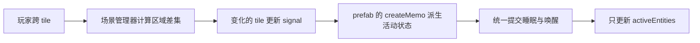

# 按 tile 管理场景实体生命周期

本文记录按 tile 管理生命周期的实施方案：每个 tile 持有一个活动状态 signal，玩家跨 tile 时更新变化的 tile，prefab 读取缓存 memo 派生自身的活动状态。活动网格、萤火虫资源加载／释放、温泉的显隐及海浪休眠移除已实现；海浪按 Lua 的 `OnEntitySleep = inst.Remove` 释放 FX，不在重新激活时恢复，详见 [海洋渲染](dst-ocean-rendering.md)。当前 [stafflight.ts](../packages/prefab/src/stafflight.ts) 仍逐帧检查距离。常青树、桦树和月树通过 [ResidentSprite](../packages/animation/src/residentSprite.ts) 保留稳定根节点，并用 `watchTileActivity()` 门控 visual 驻留；离开活动区只释放实体 visual，返回时复用共享 source 重建。实体身份、脚点、交互投影、Workable、生长和腐烂计时器不随 visual 重建。活动集合由 tile effect 更新，无每帧全量加载／卸载扫描；月树在 `bindWorld()` 前保留空根节点，未注入查询或查询返回 `undefined` 时按通用驻留约定保持 active。其他实体的统一资源卸载尚未全部接入。

[worldContent.ts](../packages/signals/src/worldContent.ts) 已提供 `GetTileStateAtPoint(tile, radius = 10)`，从当前绑定世界解析 tile 查询服务，`tile` 是实体自己的 tile key（`ReadonlySignal<number>`），返回 `Memo<boolean> | undefined`，调用方无需传入玩家位置源。实体用 [tileManager.ts](../packages/componets/src/tileManager.ts) 的 `TileTracker` 持有私有 tile key：构造时传入读取当前位置的函数（如 `() => transform.position`），用 `GetTileKeyAtPoint` 计算 key（网格外或非有限坐标为 `INVALID_TILE_KEY = -1`）。只有跨 tile 时 key 才变化，同一 tile 内移动不通知下游 memo，也不分配新向量；位置的权威数据仍在实体上，key 在刷新时通过读取函数取当前向量，所以原地修改和整个替换位置引用都能被读到，但只有刷新（见下）发生时才会更新。实体每次给位置赋值后调用 `tracker.moved()`，累计 60 次（可通过构造参数 `interval` 调整）才刷新一次 key，计数由实体自己的 tracker 持有；休眠实体的 `update` 被跳过，位置不赋值就不计数。掉落、传送等一次性位置跳变用 `sync()` 立即刷新并重新计数。消费者通过 `getWatchWorldContent(key, cleanup, { tile })` 传入 `tracker.tile` 完成门控，清理时释放 memo。世界初始化时通过 [tileManager.ts](../packages/componets/src/tileManager.ts) 的 `GetTileStateAtPoint(playerPosition)` 柯里化绑定源，将返回的查询函数注入 `WorldContentEnvironment.tickingarea`；`world.tickingarea(tile, radius)` 始终查询所属世界，全局导出查询当前绑定世界。signals 包只定义服务协议和解析入口，网格计算及缓存仍由 tileManager 管理。

世界创建时先调用 `BindTileMapSize(world.map.generator.options.size)` 注入世界坐标尺寸。每格 12 单位，有符号地皮范围为 `floor(-size / 24)` 到 `ceil(size / 24) - 1`，key 偏移和网格边长从该范围推导，包含边缘不足整格的地皮；坐标有效范围仍严格为 `[-size / 2, size / 2)`。`TileTracker` 和绑定的查询保留各自世界的配置；世界释放时解除尺寸绑定，旧世界释放不会解除新世界绑定。独立组件场景若需要活动查询，也须先注入尺寸；未绑定时坐标 key 无效。

当前 `WorldState` 从自己的 `playerpositions` 快照纯派生首个玩家位置；没有玩家时为 `undefined`，所有 tile inactive。位置沿用现有初始化和每 60 活动帧采样，不改变更新频率或增加多人并集。范围采用下述方形规则，半径须为非负整数；目标初次查询时超出存档地图范围或 X/Z 无效则返回 `undefined`（该实体之后不会被门控，即使移入网格；会从网格外生成的移动实体需要自行处理）；已有 memo 的实体移出网格时返回 `false`。玩家 X/Z 无效时发布 inactive。缓存按世界绑定的位置源隔离，同一世界、同一个实体 tile signal 对象和半径的查询返回同一个 memo；两个实体即使当前 tile key 数值相同，也有独立 memo，以便以后分别跨格。各实体共享当前格子的活动 signal；不同世界或半径独立。

每个玩家位置源仅创建一个私有 `watchSignal` 桥接和一个普通 `createEffect` 管理器。每个已使用的半径拥有按注入地图尺寸创建的独立 `titlestates: Signal<boolean>[][]`。玩家跨 tile 后，先遍历旧活动方形区域，将不属于新区域的格子设为 inactive；重叠区域保持原值。随后从新玩家格开始，按方形螺旋逐圈激活新区域，超过活动半径立即停止，仅写入变化的 signal。整个过程用 `batch()` 一起提交，先关闭旧区域再激活新区域，传送也不会遗留旧 active 格。

第 0 圈为玩家格；其余各圈从负 X、负 Z 的角开始，依次沿 +X、+Z、−X、−Z 遍历四边，角点不重复。地图边缘裁剪每条边，玩家在地图外时跳过完全不相交的内圈，不因单个越界格终止遍历。玩家坐标无效时只关闭旧区域，没有全图兜底遍历。

玩家同 tile 内移动直接跳过网格遍历。每个实体的缓存 memo 先读取自己的 tile key signal，再读取该 key 对应格子的活动 signal，不直接依赖玩家精确位置。实体发布新 key 时，memo 自动解除旧格子的依赖并订阅新格子；玩家移动则通过当前格子的活动值变化触发 memo。实体在同 tile 内移动不会发布新 key，其他格子的活动变化也不会触发该实体的 memo。查询复用更新好的状态；新半径第一次查询时初始化网格。每次跨 tile 至多检查旧、新两个活动区域，即 `2 × (2R + 1)²` 格，地图边缘进一步裁剪；默认 `R = 10` 至多 882 格，不再扫描全图 7056 格。当前已实现单玩家方形区域差集与半径短路；多人并集和缓冲圈仍待接入。

返回值支持 `awake()`、`get()`、`peek()`、`subscribe()`。memo 由缓存持有；同一个 tile signal 的多个消费者共享 memo，不能由某个消费者提前释放。`getWatchWorldContent` 的 `{ tile }` 门控约定该 signal 为消费者私有，其清理函数会释放世界输入监听和对应 memo；直接查询的私有 tracker 可由拥有者在永久移除时释放 memo，或交给世界统一释放。`WorldState.dispose()` 调用 `DisposeTileStates(playerPosition)` 统一释放全部 memo、排队的管理器 effect 和位置监听，再释放首个玩家位置 memo。显式调用某个 tile memo 的 `dispose()` 会将它从缓存移除，下次查询重新创建；某半径的最后一个 memo 释放时回收对应网格，整个缓存的最后一个 memo 释放时解除位置桥接。重复查询不增加引用计数，重复释放无影响。普通管理器 effect 按现有微任务调度，位置写入后的派生结果在后续宏任务观察；尚未接入帧阶段、缓冲圈和实体生命周期。

[hotspring.ts](../packages/prefab/src/hotspring.ts) 先接入显隐与碰撞切换：场景向管理器注入所属世界的查询函数，每个温泉用私有 `watchSignal` 监听脚点所属 tile，并通过普通 effect 更新活动集合、场景模型和物理体。inactive 时停止该温泉动画更新，保留原模型、逻辑记录、heater、bathbombable 和存档状态；返回范围时恢复同一实例，不重播生成或投入沐浴球动作。此阶段不释放休眠模型资源，不实现 Lua 的蒸汽 FX 分支。单个温泉永久移除时清理自己的监听，不释放共享 memo，也不影响同 tile 其他温泉。没有注入 tile 服务或查询返回 `undefined`（包括超出网格）时回退为 active，保证模型、碰撞体和动画正常工作；返回值为有效 memo 且状态为 `false` 时仍按 inactive 处理。

[dstLocalLighting.ts](../src/dstLocalLighting.ts) 由场景注入所属世界的 `tickingarea`，GPU 光照贴图与 CPU `sampleLightLevel()` 共用活动过滤。按光源的世界坐标查找 tile，同格所有光源共用一个私有 `watchSignal` 活动视图；移动或带父节点的子光源按当前世界位置查新格子。区域外或存档地图范围外的光源跳过叠加、衰减计算及光照贴图范围扩张，但不删除光源设置；玩家返回后恢复贡献。按 tile 的查询缓存保留到光照系统显式释放，同时清理私有监听和对应 memo；没有注入查询的独立场景保持不门控。

[fireflies.ts](../packages/prefab/src/fireflies.ts) 从自身私有的活动区域视图纯派生 `active`；表现层另建 `watchSignal`，用普通 effect 创建或销毁 `createSharedArchiveSprite()` 实体。`swarm_loop` 共享预合成图集和 `InstancedMesh` 批次，`swarm_pre` / `swarm_pst` 使用同一 `ArchiveSpriteAssets` 的共享帧缓存。inactive 时退出批次、释放实体 visual，只保留逻辑控制器和轻量原点，原有渐变值、工作状态、逻辑 timer 和实体身份保留；共享图集保留到资产所有者释放。再次 active 时异步重建 visual 并绑定当前动画，不重新执行掉落、消耗或实体生成；若加载期间再次休眠或移除，释放过期结果。昼夜和玩家位置继续由区域门控，休眠期间不跟随世界更新；活动状态变为 true 时，显隐 effect 重新读取同步后的昼夜，白天直接清除旧亮度、淡变及延迟检查，隐藏 visual 并禁用 NET，不等待下一帧动画或 timer。白天丢弃和活动区内进入白天也直接隐藏。首次创建会预备好 visual，确保成功落地后可立即参与捕获；绑定时已 inactive 的实体立即释放预备 visual。`GroundItemVisual.active` 表示资源已加载，`GroundItemManager` 为每条记录创建私有桥接，通过 effect 更新活动集合和场景归属；动画更新、交互候选、邻居查询和 billboard 排序只遍历活动集合，保存仍导出全部逻辑记录。拾取、永久移除、换肤替换和场景释放时解除桥接并释放资源；没有活动区域服务时照常加载。
[residentSprite.ts](../packages/animation/src/residentSprite.ts) 为固定位置的 prefab 提供统一的 sprite 驻留：`ResidentSprite`（archive sprite）和 `ResidentSpriteController`（factory sprite，支持建筑动画和墙体静态图片）持有稳定的根节点和占位 visual，并记录逻辑动画与队列；prefab 根据 `art` signal 在每次加载后重新应用朝向、build、符号覆盖、图层和颜色。`setActive(false)` 把 sprite 交还所有者（共享 factory 或 assets）；`setActive(true)` 重建并回到记录的状态。inactive 期间请求或正在进行的过渡动画不会回放，而是直接落在其完成状态，并照常触发完成回调。`bulb_plant`、`lightflier_flower`、`lightflier`、`mushtree`、`cave_entrance`（封闭与开放入口共用一次预载的共享 source，开采完成时同步创建开放入口）、`stickheads`（苍蝇子 sprite）、`grotto_pool`（水面与雾）和 `AnimatedBuildingPlacement` 的全部建筑都通过 `watchTileActivity(model, tickingarea, onActive)` 接入；未提供 `tickingarea` 时始终 active。建筑按 archive／build／skin 共享 sprite source（`createAnimatedSpriteSource`），只有预览持有私有 source，因为预览会修改材质透明度；换肤时 `adopt()` 交换 source 和已加载的 sprite，`userData.animationController` 保持同一对象。`mushroom_plant` 通过 `PickablePlantDefinition.archiveSprite.resident` 选择接入：`PickablePlantManager` 把共享 archive sprite 包进 `ResidentSprite`，并由 `PickablePlantWorld.tickingarea` 门控；其他植物定义不设该选项时行为不变。

visual 由驻留对象的私有 signal 持有，普通 `createEffect` 在加载、卸载和换肤后切换矩阵更新入口，沿用现有异步调度。空 visual 的根节点不参与每帧渲染矩阵计算或缓存比较，世界坐标需要通过显式 `updateWorldMatrix()` 查询刷新；唤醒后强制刷新矩阵。实体脚点、组件和逻辑计时器独立保留，附加 FX 子节点仍按常规更新。永久移除清理 effect 和矩阵入口。

花朵、`marbleshrub`、`marblebean_sapling` 和 `rock_avocado_fruit_sprout_sapling` 也使用 `ResidentSprite`，场景将所属世界的 `tickingarea` 注入各 manager。每个 manager 只拥有一份 `ArchiveSpriteAssets` 和预载入口，植物使用 `instancedAnimations: 'all'`，非循环动画仍保持原有完成／末帧语义。`art` effect 恢复相机朝向，大理石灌木另按 prefab 的形状、明度和最新雪量重设外观。休眠保留 Pickable、Workable、Growable、命名 timer、碰撞登记和小地图；生长、破土完成及开采后移除通过游戏时间调度器执行。火焰 visual 和声音按活动状态释放，燃烧 timer 继续。花朵列表和存档由逻辑记录提供，渲染条目只包含已加载 visual。

墙体通过 `createStaticSpriteFactory()` 按实际 build、skin 和控制器配置共享 atlas 与帧几何，`ResidentSpriteController` 保留实体根节点和健康值决定的静态姿态。`showImage()` / `setFacing()`、草墙颜色和预览透明度由 prefab 的 `art` effect 重新应用；预览的私有材质不影响已建墙。栅栏通过 `createSharedArchiveSprite()` 和 `ResidentSprite` 驻留，保留宽／窄 bank、旋转、皮肤、实体和组件；预览仍在两个 bank 间切换，换肤通过 `adopt()` 保留逻辑动画与回调。两者只在放置或读档定位后用 `watchTileActivity()` 绑定活动区，休眠不注销物理或清除组件。栅栏燃烧计时和热传播继续由组件更新，火焰 visual、声音和光照随活动区释放／恢复，燃烧完成仍可在休眠时移除实体。所有实体与预览先释放，manager 再统一释放共享 source。

`ResidentSprite.setActive(false)` 还会把稳定根节点从父节点摘下，`setActive(true)` 时挂回同一个父节点，使投影、矩阵更新等场景遍历跳过 inactive 实体；根节点、位置、组件和逻辑 timer 仍由所有者持有。所有者在 inactive 之后才把根节点加入场景时，加入事件会立即再摘下，不会落入场景。因此 inactive 的 `ResidentSprite` 根节点不在 `scene.children` 中，通过场景遍历查找实体的代码看不到它们（`FindEntities` 本来就只返回带 `tickingarea` 标签的实体）。`ResidentSpriteController` 尚未采用这一做法。

[actionEntity.ts](../packages/prefab/src/actionEntity.ts) 的世界绑定统一维护 `tickingarea` 标签和活动实体索引。每个投影持有私有 tracker、区域 memo 和 `watchSignal`，普通 effect 在 active 时添加标签及索引，inactive 时移除；带底层 `ItemEntity` 的投影仍通过该实体的标签 API 写入，不维护第二份权威标签。`FindEntities` 只遍历活动索引，保留场景归属、移除状态、must/cant/oneof 标签和半径过滤，不读取 inactive 候选的位置。标签不控制可见性，白天隐藏但仍在活动区域的萤火虫也可带此标签；鼠标交互仍由可见性和 `NOCLICK` 规则控制。

世界绑定仅建立一个玩家位置 `watchSignal`，沿用现有每 60 活动帧发布的位置快照，批量刷新登记实体的 tracker；玩家停留原 tile 时也刷新移动实体的位置。该采样会检查登记实体，但不会在每次 `FindEntities` 或每个渲染帧扫描全部实体。模型 `added` 时立即同步实际脚点，避免创建模型后才赋位置导致一直查询出生格。查询返回 `undefined` 的原有无门控分支保持 active。拾取、换肤等模型替换释放旧投影订阅；树木的 visual 休眠保留根节点上的同一投影，永久移除及场景销毁才释放投影、标签和索引，逻辑实体保存不受影响。effect 仍在后续微任务提交，测试在后续宏任务观察区域切换。

地面实体的每帧动画更新不再无条件同步空间／放置索引：脚点移动时同步两者，抛物过程同时同步视觉高度；标签变化仍由事件立即同步，动画包围范围扩大仍由 renderer 发布并在查询前刷新。相机视锥裁剪与 tickingarea 分开：离屏的完整帧不提交实例数据，但其逻辑动画、光源和共享资源保持原生命周期。

```ts
import { GetTileStateAtPoint } from '@dontstarve-web/signals';
import { TileTracker } from '../packages/componets/src/tileManager';

const tracker = new TileTracker(() => entity.position); // 每个实体私有；每次位置赋值后 tracker.moved()
const active = GetTileStateAtPoint(tracker.tile); // 默认 10 格；同一个 tracker.tile 和半径复用 memo
const stop = active?.subscribe(isActive => queueTransition(isActive));
// prefab 永久移除时释放订阅和这个私有 tracker 对应的 memo。
stop?.();
active?.dispose();
```

开发约束见 [AGENTS.md](../AGENTS.md)，响应式原语见 [packages/signals](../packages/signals/README.md)，存档与渲染规则见 [存档系统](dst-save-system.md)、[billboard 绘制](dst-billboard-rendering.md)。

## 移动实体不能一直监听出生 tile

问题场景：蜘蛛生成在玩家活动范围内的 tile A，初始化时将活动 memo 固定绑定到 A。之后蜘蛛移动到远处的 tile B，若自身的格子绑定没有更新，它仍读取 A 的活动状态。只要玩家仍使 A 保持 active，蜘蛛即使已经离开活动区域也不会休眠，可以持续向远处移动。仅在玩家跨 tile 时更新活动网格无法解决这个问题：网格状态本身正确，错误在于蜘蛛仍监听出生格子。

当前查询通过实体自己的 tile key signal 解决固定格子绑定的问题。玩家和实体分别提供两条更新路径：

1. 玩家位置采样变化后，管理器更新活动网格；实体当前监听格子的活动状态发生变化时，其 memo 重新计算。
2. 实体的位置写入完成后调用 `tracker.moved()`；采样刷新时通过读取函数获取实际位置，计算并发布新的数字 key。活动 memo 读取新 key，自动切换到新格子的活动 signal，不再依赖出生格子。

蜘蛛从 A 移到活动区域外的 B 后，下一次实体 tile 采样使 memo 读取 B 的 `false`，由接入方执行该 prefab 的休眠处理；即使 A 始终保持 active，也不会再让蜘蛛继续活动。玩家和生物同时移动时，两条路径都能触发重新计算，最终状态按双方最新已发布的位置判定。

缓存必须按实体的 tile signal 对象和半径区分，不能仅按当前数字 key 复用实体 memo：两只蜘蛛即使同格生成，也可能向不同方向移动。它们共享格子的活动 signal，各自的 memo 保留独立的 tile 依赖。

移动 prefab 接入时必须保留自己的 tracker，在位置赋值后调用 `moved()`；构造时读取一次位置、之后只修改 `Vector3` 不会自动更新 key。当前默认累计 60 次位置写入再刷新，允许持续移动生物在采样之间存在位置误差；这不是每次跨格都立即休眠，也不是世界统一计时的 60 帧任务。掉落、传送和加载后的位置赋值通过 `sync()` 立即刷新。刷新只读取现有向量并计算数字 key，同格时 Signal 过滤相同值，不创建新向量或包装对象，也不触发下游 memo。

这一机制解决的是移动实体的格子依赖更新；具体生物仍需将位置提交和休眠行为接入上述接口，不能仅创建 tracker 就认为完成接入。实体／tile 索引迁移和统一资源卸载仍属于后文的生命周期方案。

### 活动边界的误差容忍

蜘蛛等持续移动生物允许按采样位置判断活动范围，不要求每次跨格都立即切换休眠状态。默认累计 60 次位置写入刷新一次 tile key，是有意保留的性能取舍，具体容忍如下：

- 连续移动时，最多有 59 次位置写入尚未反映到 tile key；刷新前可以继续读取上次采样格子的活动状态。误差按实体的位置写入次数计算，不保证固定的游戏时间、实际时间或空间距离上限。
- 如果未满 60 次就停止移动，允许 tile key 保留在上次采样的格子，直到继续移动累计到刷新次数或显式调用 `sync()`。停止移动本身不强制补刷，也不为此增加全局扫描或定时刷新。
- 玩家位置和生物 tile key 分别采样，同时移动时按双方最新已发布的位置判断，允许采样不同步造成的活动边界延迟；不承诺每帧都匹配双方的即时相对位置。
- 掉落、传送和加载后的一次性位置赋值调用 `sync()` 立即刷新并重置计数，不能等待后续移动来凑满次数。

误差容忍只适用于活动范围的粗粒度判定，精确位置仍由实体的实际 `Vector3` 提供，碰撞、动作距离和存档位置不能用采样 tile key 替代。需要避免的是实体持续移动时永远监听出生格子；允许采样间隔内暂时使用旧格子，不将其视为该问题未解决。

## tile 与状态来源

活动网格复用 [tile.ts](../packages/prefab/src/tile.ts) 的 `TILE_SIZE = 12`。以实体实际地面脚点计算有符号坐标，与 `TurfMap` 和存档地皮坐标一致：

```ts
const col = Math.floor(position.x / TILE_SIZE);
const row = Math.floor(position.z / TILE_SIZE);
const tileKey = `${col},${row}`;
```

例如 `x = -0.1` 属于 `col = -1`，`x = 12` 属于 `col = 1`。活动索引采用有符号坐标；`TileMap.worldToTile()` 的地图中心偏移属于地皮数组索引，两者转换时需要显式处理。跳跃高度、sprite 中心和包围盒不参与 tile 归属。

每个登记的 tile 创建一次 `Signal<boolean>`：`true` 表示 active，`false` 表示 inactive。同一 tile 内的所有 prefab 共用该 signal；同一 key 在存活期间始终对应同一个 signal 对象。场景管理器拥有写权限，prefab 接收 `ReadonlySignal<boolean>`，只读取活动状态。地皮类型和活动状态分别存储；踩踏、挖地或改变地皮类型不会替换活动 signal。

目标数据结构示意：

```ts
interface ActivityTile {
  key: string;
  active: Signal<boolean>;
  entities: Set<EntityId>;
}

tiles: Map<TileKey, ActivityTile>;
activeTiles: Set<TileKey>;
activeEntities: Set<EntityId>;
entities: Map<EntityId, LogicalEntity>;
```

tile 可以按需登记，避免为整张空地图预先创建 signal。管理器保留活动区域的 key 集合；新登记 tile 的 signal 根据当前区域初始化，不能一律初始化为 inactive。空的 inactive tile 只有在实体迁出且所有订阅释放后才可回收。

## 玩家跨 tile 时发布变化

每帧只计算一次玩家所在 tile。玩家仍在同一 tile 时，活动区域不重算，也不重复写入 tile signal。首次启动、玩家跨 tile、传送、活动半径调整或玩家加入／离开时，重新计算区域并更新差集：

1. 计算新的 active tile 集合。
2. 对离开区域的 tile 执行 `active.set(false)`。
3. 对进入区域的 tile 执行 `active.set(true)`。
4. 保持交集内的 signal 不变，再统一处理 prefab 状态切换。

活动范围以整块 tile 为单位，属于粗粒度可见／更新区域，不再保证原先逐实体的精确圆形距离边界。范围规则由管理器统一配置，例如以 `max(abs(col - playerCol), abs(row - playerRow)) <= R` 定义方形区域。可采用进入半径 `R`、保留半径 `R + 1`：外圈只保留已激活 tile，超过外圈才卸载，减少玩家在边界往返时的资源抖动。具体半径是实施配置，不视为原版 DST 的引擎参数。

多人场景使用所有玩家活动区域的并集；一个玩家离开后，仍被其他玩家覆盖的 tile 保持 active。传送直接计算新旧集合差集，无需依次经过中间 tile。

### 从玩家 tile 开始螺旋遍历与短路

活动区域从玩家当前所在 tile 开始，按方形螺旋逐圈向外枚举：第 0 圈只有玩家 tile，第 `r` 圈包含 `max(abs(deltaCol), abs(deltaRow)) == r` 的边界 tile，每个 tile 只访问一次。同一圈内采用固定方向与起点，保证遍历和资源加载顺序稳定；负坐标沿用前述有符号 tile 坐标。

对进入半径 `R`、保留半径 `R + 1` 的方形区域，枚举第 0 圈到第 `R + 1` 圈后立即停止，不继续搜索更远 tile。内圈纳入新的活动集合，保留圈只纳入此前已经 active 的 tile。`spiralRing()` 是拟新增的逐圈枚举器，以下示意只计算区域，不直接加载资源或写 signal：

```ts
const nextActive = new Set<TileKey>();
const retainRadius = enterRadius + 1;

for (let ring = 0; ring <= retainRadius; ring++) {
  for (const tile of spiralRing(playerTile, ring)) {
    if (!isWithinMap(tile)) continue;
    const key = tileKey(tile);
    if (ring <= enterRadius || previousActive.has(key)) {
      nextActive.add(key);
    }
  }
}
```

`previousActive` 是本次更新前的活动集合快照；多人时先为各玩家计算候选集合并取并集，最后统一发布差集。区域中的空 tile 仍可保留 key，使随后生成的 prefab 能正确初始化活动 signal，不需要为每个空 key 创建 tile 对象或 signal。

短路必须建立在“所有后续圈都无法满足活动／保留范围”的条件上。遇到 inactive、未登记、没有实体或越过地图边界的单个 tile 时，只跳过该 tile，不能结束整条螺旋；同圈或后续圈可能仍存在范围内的有效 tile。普通方形螺旋只保证圈半径递增，不保证欧氏距离逐点递增。例如圆形半径为 1 格时，`(1, 1)` 在圆外，但同圈的 `(0, 1)` 仍在圆内；改用圆形范围时，需要根据剩余整圈的距离下界判断能否结束，不能在第一个圆外 tile 处 `break`。

结束新区域枚举后，仍要处理 `previousActive - nextActive` 中的全部 tile，保证旧区域外的实体及时卸载。尤其是传送时，旧活动区域可能完全不在本次螺旋搜索范围内；卸载差集不能依赖新区域的枚举路径。

新增 tile 的唤醒／加载队列沿用从玩家 tile 向外的螺旋圈顺序，同圈按固定顺序处理，使近处区域优先准备。圈顺序表示 tile 网格距离优先，不保证同圈实体的精确欧氏距离顺序。需要限制单帧模型创建量时，可以在达到时间或数量预算后暂缓加载队列，下一帧继续；活动区域与 signal 差集仍完整计算、统一提交，尚未准备好的实体保持在活动更新集合之外。玩家再次跨 tile 后，队列重新校验目标区域及请求代次，取消已失效的任务。

螺旋遍历的作用是限定搜索范围、明确停止条件并安排加载优先级。完整枚举半径内方形区域仍是 `O(R²)`；主要性能收益来自局部 tile 索引与仅更新活动实体。玩家只移动一个相邻 tile 时，后续还可按新增／离开的边缘增量更新区域，减少重复枚举交集。



## prefab 用 createMemo 派生状态

prefab 的 `awake` 是所属 tile 活动状态的派生值，实际模型是否存在是资源状态，两者分别维护。memo 只计算状态；加载、卸载、计时补算和音效播放由生命周期处理函数执行。

当前运行时由 `TileTracker.tile` 驱动查询 memo 切换格子依赖。以下是后续接入实体索引时的等价示意，`activity.queueTransition()` 和 `tileRegistry.get()` 是拟新增的管理器接口：

```ts
// 固定实体可以直接闭包读取 tile.active.get()。
// 移动实体用 signal 保存所属 tile 的只读活动 signal。
const tileActivity = createSignal<ReadonlySignal<boolean>>(
  readonlySignal(tileRegistry.get(position).active),
);

const awake = createMemo(() => tileActivity.get().get());

const stopWatching = createEffect(() => {
  activity.queueTransition(entityId, awake() === true);
});
```

`awake()` 读取缓存的派生值。同一个 tile 状态变化时，该 tile 内 prefab 的 memo 才重新计算；玩家在 tile 内移动不会触发它们。prefab 跨 tile 时，迁移实体索引并用 `tileActivity.set(nextTile.active)` 切换依赖，memo 重新追踪新 tile。`.get()` 用于收集依赖，`.peek()` 不会建立 memo 的依赖。

移动实体的归属变更由移动／传送提交路径负责，创建、掉落、拾取、永久移除也必须登记或注销索引。即使玩家没有跨 tile，实体跨 tile 仍会更新自己的绑定；无需重新发布未变化的 tile 活动 signal。

同为 active 的两个 tile 之间迁移时，`awake` 仍为 `true`，不重复创建模型或音源。两个 inactive tile 之间迁移只更新逻辑位置与归属；active 与 inactive 之间迁移才触发加载或卸载。

### 现有 createMemo 的实施前提

[signal.ts](../packages/signals/src/signal.ts) 当前的 `createMemo` 使用同步内部 effect 计算缓存；`batch()` 在最外层提交时结算 memo，再通知同步订阅者。普通 `createEffect` 仍在微任务中合并更新，观察它的结果时在后续宏任务断言。

实施时仍需要建立明确的帧阶段：更新游戏时钟及位置 → 发布 tile 变化 → 完成 memo／effect 更新 → 提交生命周期转换 → 更新活动实体 → 渲染。同步 memo 已能提供派生状态，但不能假设普通 effect 的转换队列已经提交；保持现有响应式调度语义。`queueTransition()` 按实体合并同一提交阶段的最终活动状态，并先处理卸载，再处理加载。保存、停止游戏和场景退出也需要处理或取消待提交转换。

当前 `createMemo` 返回可调用的 `Memo<T>`，支持 `get()`、`peek()`、`subscribe()` 和 `dispose()`。仅调用示例中的 `stopWatching()` 不会解除独立 memo 对 tile 的订阅；拥有者还需释放 `awake`，或通过私有 `watchSignal` 的统一清理释放其拥有的消费者，确保永久移除 prefab 时清理内部依赖与排队任务。

## active 与 inactive 的生命周期

逻辑实体保存稳定的 ID、prefab ID、地面位置、皮肤与组件状态。模型、动画控制器、音源属于可卸载资源。`activeEntities` 只包含完成唤醒的有效实体；每帧更新与 billboard 排序只遍历这个集合，避免对 inactive 实体继续进行距离检查或动画更新。

| 转换／事件 | 处理顺序 |
| --- | --- |
| 首次在 active tile 创建 | 登记逻辑状态，准备资源，创建模型并加入活动集合；普通生成可播放源 prefab 的出现动作 |
| 首次在 inactive tile 创建／恢复 | 登记逻辑状态和时间基准，绑定 tile signal，暂不创建独立模型与音源 |
| active → inactive | 结算尾帧，记录已结算时间，移出活动集合与场景，停止并断开音源，释放独立模型资源 |
| inactive → active | 补算游戏时间，检查是否过期／失效；仍有效才原地创建模型、恢复组件外观与音源，再加入活动集合 |
| 永久移除 | 注销 tile 与实体索引，释放模型和音源，取消待提交转换／资源请求，释放 effect 与 memo 的依赖 |
| 场景退出 | 停止更新，取消待提交转换与加载，移除所有实体订阅，释放管理器拥有的共享资源 |

重新激活已有实体恢复待机或对应组件状态，不重播首次生成的出现动画／音效。恢复后实体 ID、位置、皮肤及组件身份保持一致。加载失败时保留可重试的逻辑实体，尚未准备好的模型不加入活动更新集合。

动画实体使用现有 sprite factory：卸载通过 `disposeSprite()` 摘除该实体的网格并释放其私有几何；同类实体共享的纹理、材质和逐帧几何（`FrameGeometryCache`，有符号覆盖、隐藏层或皮肤的实例不参与共享）由 factory 管理，场景退出时统一释放。声音继续使用 [sound.ts](../packages/prefab/src/sound.ts) 的 `PreloadSounds`、`PlaySound` 和 `DisposeSounds`；每个活动实体有独立音源。活动范围、渲染层级和绘制顺序遵循现有 billboard 规则，重建后仍以逻辑实体的地面脚点排序。

异步准备资源时，为实体保存加载代次或取消标记。完成后重新检查实体仍存在、仍需要 active 资源且请求代次有效，再绑定模型；已卸载或永久移除的实体不能因旧请求完成而复活。准备完成时按当前游戏时间补算，避免加载耗时延长寿命。过期实体直接清除，不短暂创建模型、灯光或音源。

inactive 逻辑实体仍参与存档及需要完整世界状态的查询，例如建筑阻挡、地面占用或实体身份查找。可见实体集合不能替代这些查询的权威来源。

## 静态碰撞体的活动生命周期

[`PhysicsWorld`](../packages/componets/src/physicsWorld.ts) 在物理基础设施层维护完整刚体登记及 Cannon 的活动模拟集合。Prefab 继续负责创建、保存和永久移除自己的刚体；`addBody` 登记一个刚体，`removeBody` 解除登记。登记静态有限碰撞体时，物理世界创建私有 `TileTracker`、通过注入的 `tickingarea` 取得 memo，并用私有 `watchSignal` 和 `createEffect` 调用活动切换方法。Prefab 无需各自编写距离轮询或物理控制器。

- 活动格：原刚体加入 Cannon，更新 AABB 并使粗筛排序失效。
- 休眠格：原刚体从 Cannon 移除，但保留在 `registeredBodies`，位置、形状、组件及 prefab 身份不变；唤醒重新使用同一刚体。
- 永久移除：解除 tile 监听和 memo，再从活动模拟集合移除，之后的 tile 激活不能恢复它。
- 场景销毁：先释放 prefab，再 `PhysicsWorld.dispose()` 释放剩余登记和监听，随后释放世界 tile 状态。未注入活动查询或初始位置在网格外时保持原有模拟行为。

`bodies` 表示实际模拟集合；`registeredBodies` 及 `getRegisteredPhysicsBodies()` 用于完整逻辑查询。寻路阻挡、出生占位和碰撞材质收集读取完整登记，不能因为休眠而认为该处没有障碍。温泉的视觉和蒸汽仍由 prefab 的醒睡回调管理，碰撞体只在创建／永久移除时登记／注销；墙体损毁和修复仍按 Lua 显式注销／重新登记障碍，栅栏移除也会注销休眠碰撞体。动态／运动学刚体沿用自身现有生命周期，无限地面不按单个 tile 门控；本次不改变 NPC 的活动调度。静态刚体所有者若迁移坐标，应调用 `syncBody()` 刷新 tile 与 AABB。活动更新沿用现有信号调度和玩家位置快照，不逐帧扫描全部静态刚体。

Cannon 原来的 `ArrayCollisionMatrix` 用稠密数组保存接触历史，其容量随刚体数量平方增长，并通过会在移除／唤醒时重排的 `body.index` 标识接触。物理世界改用引擎自带的 `ObjectCollisionMatrix`，以稳定 `body.id` 保存实际接触。`ContactMatrix` 只适配 Cannon `World` 声明的数值接口；接触计算、求解、掩码及 SAP 粗筛仍由 Cannon 执行。这样休眠切换不会因为索引变化重复触发仍在持续的碰撞。

动画几何和对象变换分别失效：共享 archive sprite 的帧几何已烘焙所有零件变换，换帧无需重新计算整个静态 billboard 子树的矩阵。移动／旋转、相机朝向及镜像缩放变化仍使矩阵失效；空间包围范围扩大仍通过 `publishSpriteSpatialBounds` 通知索引，拾取继续读取当前帧几何。附加 FX 子节点仍沿用矩阵门控的动态子树规则。

验证用 `physicsWorld.test.ts` 覆盖千个休眠碰撞体、活动边界、唤醒身份保持、迁移、移除／销毁和碰撞历史；`sharedArchiveSprite.test.ts` 覆盖换帧与变换失效的边界。完整洞穴浏览器流程继续验证输入、绘制及 `c_save()` 导出重载，休眠刚体不影响实体存档。

2026-10-20 的本地整图初始位置单轮采样（同一脚本、91 次 `world.step`、273 个物理子步）中，完整登记保持 1,618 个刚体，参与模拟从 1,618 个降为 2 个。物理步进总耗时约 `604 → 13 ms`，其中 SAP 粗筛约 `493 → 2 ms`、接触历史轮换约 `39 → 0.6 ms`。浏览器使用 SwiftShader 软件渲染，平均总帧时间约 `166 → 171 ms`，没有观察到整体帧率提升；这些数字仅说明该采样中的物理 CPU 开销下降，不能推算硬件浏览器的帧率。同一脚本移到蓝蘑菇林后，登记仍为 1,618 个，活动刚体为 82 个，91 次步进总耗时约 18 ms，确认密集区域的碰撞体已唤醒。

## 每 60 帧结算与休眠补算

场景管理器维护由有效游戏 `dt` 推进的共享时钟。inactive tile 不需要自己的逐帧时钟；prefab 保留最近一次结算时的游戏时间，唤醒时用共享时钟的差值补算。游戏暂停、停止或无效时间步不推进时钟，也不消耗生命周期。

以 `stafflight`／`staffcoldlight` 为例：

1. active 时累计有效游戏帧数与实际 `dt`，每 60 帧结算一次剩余寿命；附近动画和光照脉动继续逐帧更新。
2. tile 变为 inactive 时结算不足 60 帧的部分，更新 `lastSettlementSeconds`，然后卸载资源。
3. inactive 时保留逻辑状态与订阅，暂停独立模型工作，不逐帧扣减寿命。
4. tile 再次 active 时计算 `elapsed = gameTime - lastSettlementSeconds`，一次扣减所有未结算时间。过期的移除，未过期的恢复并开始新的 60 帧批次。

发生转换的时间步只能结算一次；同一帧唤醒补算后，活动更新不能再次扣减已经计入的 `dt`。正常到期的星体保留源 Lua 的消失动作与清理流程；休眠期间已过期的星体在补算后直接移除。

tile 的 inactive 状态暂停逐帧工作，具体组件决定休眠期间如何推进领域状态。星体寿命等计时状态继续按游戏时间流逝；需要暂停的行为记录暂停状态。食物、燃料及其他组件仍遵循各自的领域规则和转移／停止前结算要求，不能仅因为同处一个 tile 而统一冻结所有时间。

### 腐烂累计刻度与早晨快照

[WorldPerishClock](../packages/componets/src/worldperishclock.ts) 和 [Perishable.Update(tick)](../packages/componets/src/perishable.ts) 已接入现有场景；统一 tile 管理器、早晨批量任务和无模型的地面腐烂替换仍待实施。

世界为每段有效游戏时间累计温度加权秒数：`C(t) = Σ(dt × temperatureMultiplier)`。已移植的普通物品分支中，温度 `< 0` 为 `0.75`，温度 `> 70` 为 `1.25`，其余为 `1`。世界温度仍每 60 个活动帧更新，累计器使用该时间段内实际生效的温度，不推测两次温度更新之间的连续变化。相同倍率的相邻区间合并保存，`GetTick(time?)` 返回不可变的 `{ time, total: C(time) }`，可在已记录范围内查询指定时间。

组件保存上次已结算刻度，消费 `current.total - previous.total`，再乘持有者、湿润和本地倍率。普通活动结算通过游戏时间调度器每 10 个游戏秒执行，尾帧保存与将来的早晨／唤醒补算也走同一入口；同一刻度重复提交不再次扣减，倒退刻度会被拒绝。当前周期任务直接登记到世界共享调度器；仅卸载模型时保留逻辑组件、周期任务和世界累计基准，不能调用 `StopPerishing()` 或 `dispose()` 来表示仅卸载模型。创建／恢复时先绑定世界，避免把生成前的时间计入新物品。

未来由管理器通过游戏时间调度器登记早晨边界，读取该边界的累计刻度，然后对 inactive 实体结算：

```ts
const tick = world.perishClock.GetTick(morningGameTime);
for (const entity of inactiveEntities) {
  entity.components.perishable.Update(tick);
}
// 提交腐烂替换／移除后的逻辑实体，再生成 tile 快照。
```

任务跨多个早晨时按各边界推进，不能订阅全局时钟信号逐帧检查。保存、提前唤醒和改变持有者／湿润状态也需要结算到相应刻度，随后只补算新产生的差值；组件处于真正的暂停状态时不扣减，恢复时重设累计基准。当前区间只保留在本次世界会话内；完整保存会先结清全部逻辑实体，读档以保存时的游戏时间和已有剩余新鲜度建立新累计原点，不需要保存整条温度历史。未来若直接保存尚未补算的 inactive 快照，则必须一并保存该快照的累计基准和之后需要的区间，不能仅保存旧百分比。

这个积分机制是本项目为休眠补算引入的设计。源 `perishable.lua` 给每个物品登记约 10～10.27 秒的周期任务，每次 `Update(inst, dt)` 根据当时温度计算整段消耗；`LongUpdate(dt)` 也读取当前温度，不回放历史。本实现保留已移植的倍率、暂停和腐烂事件顺序，但历史温度的补算语义与 Lua 不同。冻结物品、冰箱、局部温度覆盖与酸雨等未移植分支不能直接套用当前单一积分，移植时需在所属组件扩展相应的累计规则。

## 保存与恢复

`c_save()` 从全部逻辑实体导出数据，包括 inactive tile 内的实体。导出前完成待提交的活动转换，并结算所有未结算时间，过期实体不进入存档。保存稳定的 ID、位置、皮肤、数量与组件状态；tile signal、memo、活动集合和模型引用属于运行时状态，不写入存档。

恢复时先建立逻辑实体及 tile 索引，根据恢复后的玩家位置初始化 active tile signal，再为 prefab 建立 memo 和生命周期监听。active tile 中的有效实体准备并加载模型，inactive tile 中的实体保留逻辑状态。计时基准以恢复后的游戏时钟和已保存的剩余时间建立，避免重复扣减存档前已经结算的时间；恢复不重播首次生成音效。

本方案不新增调试命令或 prefab／item ID，`c_spawn`、`c_give`、`c_save` 的现有参数与支持范围继续由 [README](../README.md#调试命令debugcommand) 和共享 prefab 定义说明。

## 验证范围

实施时保持代表性覆盖：

- 同 tile 内移动不发布活动变化；跨 tile、负坐标边界和传送正确更新差集，同一 tile 的多个实体共享格子活动 signal，缓冲圈保留已有活动状态。
- 以蜘蛛为移动实体案例：出生格子始终 active，蜘蛛持续移动到区域外后，tile 采样必须切换格子依赖并发布 inactive；同时覆盖玩家和实体都移动，以及同格生成的两个实体分别迁出后互不影响。允许默认 60 次位置写入的采样误差，传送通过 `sync()` 立即刷新。
- 螺旋从玩家 tile 开始、逐圈无重复，在保留范围结束后短路；空 tile、单个圆外 tile 或地图边界不提前终止遍历，传送后旧区域仍完整卸载，加载队列按圈优先且取消失效任务。
- active → inactive 释放独立资源，inactive → active 补算并在原位置重建；已过期实体不加载，实体跨 tile 后解除旧依赖，永久移除后旧 signal 或异步请求不会重建实体。
- 保存覆盖活动与休眠实体，结算尾帧及休眠时间；恢复保留身份、位置、组件状态，共享纹理不因单个实体卸载而释放。
- 腐烂跨冷热区间使用累计量之差；重复早晨／唤醒结算不重复消耗，暂停时间被排除，改变持有者和湿润状态前按旧条件结清；读档不重放存档前的累计量。

tile 差集、计时与订阅规则用单元测试验证；浏览器保留少量实际 WebGL／音频、输入及完整保存流程。性能验证分别观察每帧活动实体数、跨 tile 的生命周期转换数量及模型创建／释放次数，不以是否使用 memo 作为性能结论。

## 首次遍历地图的卡顿：新外观的一次性准备

现象：玩家（含灵魂跳跃传送）第一次走到某片区域时卡顿，再次经过已走过的区域不卡。已用 `?perf` 埋点在真机上测量，原因是实例化渲染为每个"动画 × 外观"组合在渲染帧内同步合成图集；该合成已改为 GPU 渲染到纹理并分帧完成。tickingarea 的信号结构不是原因，未做改动。

### 原因（已测量）

实体进入活动范围时，模型和逻辑的创建很轻。重的是 [instancedArchiveSprites.ts](../packages/animation/src/instancedArchiveSprites.ts) 对每个外观只做一次的图集合成，原先在 `render` 里、该外观第一次出现在画面里时同步完成：

- 合成由 CPU 的 2D canvas 完成：先把整张源贴图 `putImageData` 解码成 canvas（每次合成重复一遍），再逐帧 `drawImage`。真机上单次合成 40～300ms，`render` 单帧最大 352ms。
- 其余阶段都不是大头：`resolve` 最大约 3～14ms，`createBatch` 约 1ms，`construct` 约 3～18ms。`preload` 的 1～2 秒是异步下载等待，不阻塞主线程，只让实体晚一点出现。
- 实体切换到新外观、树换生长阶段或皮肤时也会触发同样的合成；加载界面的 `prewarm` 只处理当时已存在的实体。

### 处理

1. **提前并分帧。** 外观第一次 `show` 时就进入合成队列，不等它出现在画面里；每帧最多花 `COMPOSE_BUDGET_MS`（4ms）推进合成，合成完成的外观才参与绘制。尚未完成的外观继续绘制上一个已完成的外观，避免实体短暂消失。加载界面的 `prewarm` 不受预算限制，一次合成完。`flush(renderer)` 供需要立即得到完整画面的调用方使用（测试夹具）。
2. **GPU 合成。** 实例化渲染使用 `createResolvedRgbaSpriteAtlasComposer(..., renderer)`：每个图集页把各帧零件按源 z 顺序画成带 UV 的四边形，写入预乘的半浮点渲染目标，再由一个全屏通道取消预乘，输出 sRGB 直通 alpha 纹理，格式与原 canvas 路径一致，因此实例化材质、`dstLighting` 和深度预通道不变。不再对源贴图做 CPU 解码，也不保留解码后的 canvas。合成期间保存并恢复渲染器的目标、清除色、`autoClear` 与 `info.render` 计数，不影响外部绘制统计。
3. **回退。** 渲染器缺少 `EXT_color_buffer_float` 和 `EXT_color_buffer_half_float` 时回退到 CPU 路径；回退路径同样分步执行，源贴图按行块解码，并在跨调用共享的 `WeakMap` 缓存中复用。
4. **同步入口保持不变。** `composeResolvedRgbaSpriteAtlases` 与 `composeRgbaSpriteAtlas` 仍同步返回 canvas 图集。

GPU 合成的做法参考了 Spine 的 three.js 运行时（不在运行时用 CPU 合成图集、预乘混合）；实现细节、参考点与未采纳部分见 [实例化精灵的 GPU 图集合成](dst-gpu-atlas-composition.md)。

### 测量方式与结果

`packages/animation/src/spritePerf.ts` 提供默认关闭的埋点，URL 加 `?perf` 启用增量汇总，控制台读 `__spritePerf.summary()`；采样前调用 `__spritePerf.clear()` 对齐区间。`__spritePerf.records` 返回最多 4096 条按时间排序的近期明细并保留 `key`，普通快速 `render` 每 60 次采样一条，但汇总统计全部调用。只有 `?perf=trace` 才为全部调用写入 User Timing；普通模式不生成这些标记或逐次打印慢帧警告，避免测量干扰。异步 `preload` 包括资源等待，嵌套阶段不能相加，`render.count` 是 manager pass 调用数。阶段：`resolve`、`construct`、`preload`、`createBatch`、`render`、`compose`（游戏中每帧的分步合成）、`compose:prewarm`（加载界面）、`compose:flush`，以及子阶段 `step:layout`、`step:decode-chunk`、`step:canvas`、`step:draw-frame`、`step:texture`（CPU 路径）和 `step:gpu-upload`、`step:gpu-frame`、`step:gpu-resolve`（GPU 路径）、`step:next`（合成器每次推进的单步）。结合 `?tileperf` 的长任务日志，可把长任务对应到具体阶段。

同一场景、同一台机器的单次运行最大值：

| 指标 | CPU 路径 | GPU 路径 |
| --- | --- | --- |
| `compose` 最大 | 118～392ms | 12ms |
| `render` 最大 | 119～352ms | 12.3ms |
| `step:next` 最大 | 139～185ms | 11.4ms |

CPU 路径的最大值在运行间波动很大（同一代码的 `step:layout` 在 3ms 与 138ms 之间变化，疑为垃圾回收或系统抖动），因此比较时以多次运行为准，不要依据单次的最大值下结论。GPU 路径的总合成时间与 CPU 路径相近，约 300ms／54 次调用，差别是被摊到各帧、单步都在预算内。

### 已知限制

- 源贴图首次上传（`initTexture`）仍是不可再切的主线程调用，最大约 10ms；每页的全屏取消预乘通道平均约 4ms。
- GPU 合成的图集是渲染目标，WebGL 上下文丢失后内容不会自动恢复，尚未实现丢失后的重新合成；原 `CanvasTexture` 路径会自动重新上传。
- 仍有少量图集页走 CPU 路径（来自 `composeRgbaSpriteAtlas` 的其他调用方，量小，未进一步追查）。
- 加载界面的 `prewarm` 只覆盖当时已存在的实体，不预热存档中尚未加载的 prefab；尚未实现按存档类型的后台预热，也未使用 Worker。

### 与 tickingarea 响应的关系

跨 tile 时的网格写入和 memo 重算（见"玩家跨 tile 时发布变化"）与外观准备发生在同一时刻，但原因测量表明首次遍历的卡顿来自图集合成，而不是 tickingarea 的信号结构。外观的合成与资源下载属于资源加载，由 tickingarea 的活动状态触发；动画是否播放仍按源 Lua 与实体自身状态决定，不由 tickingarea 决定。
